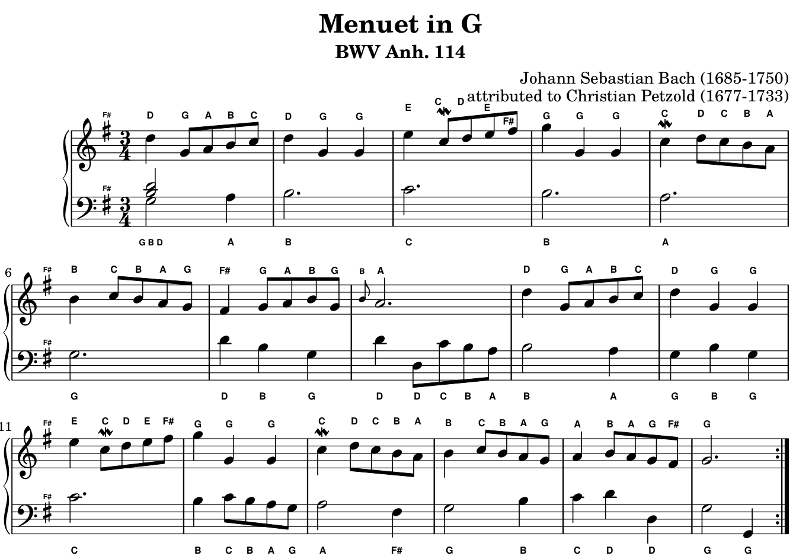
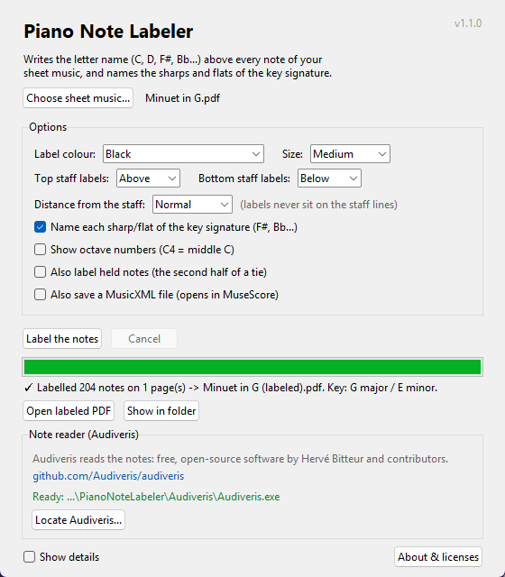

# Piano Note Labeler

Writes the letter name (C, D, F#, Bb…) above every note of your piano sheet music,
so beginners can read any piece. It also names the sharps and flats of the key
signature (for example **F#** in G major).

Give it a PDF or a scan of the music and you get back **the same page**, with the
letters added in a neat row beside each staff: by default **above the top staff**
(right hand) and **below the bottom staff** (left hand). You can choose above or below
for each. Note labels never sit on the staff lines and never touch fingering numbers or
other printing. Each key-signature name sits right on top of its own sharp or flat.



- Works on printed sheet music: digital PDFs, and scans or photos (PNG, JPG, TIFF).
- Gets sharps and flats right: key signature, accidentals that last to the end of
  the bar, naturals, and notes tied over a barline.
- Chords are labelled as a stack, top note on top.
- Runs on your own computer. Nothing is uploaded.

> **Built on [Audiveris](https://github.com/Audiveris/audiveris).** Reading the notes
> off the page (optical music recognition) is done entirely by Audiveris, the free,
> open-source project by Hervé Bitteur and contributors. This app adds the
> beginner-friendly part on top: working out each note's letter name and writing it
> neatly onto your original sheet music. Many thanks to the Audiveris team.

## Install (Windows): one download, nothing to install

1. From this project's [Releases](../../releases) page, download
   **`PianoNoteLabeler-Windows.zip`** (about 110 MB).
2. Unzip it, open the `PianoNoteLabeler` folder, and double-click
   **`PianoNoteLabeler.exe`**.

That's it: no Python, no Java, no separate installs. The zip contains the app and
[Audiveris](https://github.com/Audiveris/audiveris), the free program that reads the
notes off the page. Keep the `Audiveris` folder next to `PianoNoteLabeler.exe`.

The first time, Windows may say "Windows protected your PC": click **More info**, then
**Run anyway**. (The app isn't signed with a paid certificate.)

**Already have Audiveris installed?** Download just `PianoNoteLabeler-Windows.exe`
(30 MB) instead. It finds Audiveris by itself; if it doesn't, click
**Locate Audiveris…** and pick `C:\Program Files\Audiveris\Audiveris.exe`.

## Install (macOS / Linux), or run from the source code

1. Install Audiveris from its [releases page](https://github.com/Audiveris/audiveris/releases)
   (macOS `.dmg`, Ubuntu `.deb`).
2. Install [Python 3.10 or newer](https://www.python.org/downloads/).
   On Ubuntu/Debian also run `sudo apt install python3-venv python3-tk`.
3. Download this project (green **Code** button → **Download ZIP**) and unzip it.
4. Start it:
   - **Windows:** double-click `run_windows.bat`
   - **macOS / Linux:** run `./run_mac_linux.sh` in a terminal

   The first start takes about a minute while it installs its one library (PyMuPDF).

## How to use it



1. Click **Choose sheet music…** and pick a PDF or an image. You can pick several files.
2. Click **Label the notes**. Reading the music takes about 15–25 seconds per page.
3. Click **Open labeled PDF**. The result is saved next to your file as
   `<name> (labeled).pdf`. Your original file is never changed.

Options:

| Option | What it does |
| --- | --- |
| Label colour | Black (the default), blue, red, green, or **Rainbow**: each letter gets its own colour (C red, D orange, E yellow, F green, G blue, A indigo, B violet). |
| Size | How big the letters are. |
| Top staff labels | **Above** (default) or **Below** the top staff (piano: right hand). |
| Bottom staff labels | **Below** (default) or **Above** the bottom staff (piano: left hand). If both go between the hands, each staff's letters stay in their own half of the gap. |
| Distance from the staff | How far from the staff the row of letters sits: Close, Normal or Far. |
| Name the key signature | Writes F#, Bb… right on top of each sharp or flat of the key signature. |
| Show octave numbers | `C4` instead of `C` (C4 is middle C). |
| Also label held notes | Labels the second note of a tie too. Off by default, because you don't play it again. |
| Also save a MusicXML file | Saves the recognised music, which you can open and fix in MuseScore. |

Changing options and labelling the same file again is instant: the app remembers
what it read.

### Getting good results

- **Digital PDFs work best**: ones made by notation software (MuseScore, Sibelius,
  LilyPond), like most of IMSLP's typeset scores and the Mutopia Project.
- **Scans:** 300 DPI, black and white, page straight. Phone photos work if they're
  sharp, flat and evenly lit.
- **Handwritten music doesn't work.**
- Note reading is good but not perfect. A smudge or an unusual symbol can give a
  wrong or missing letter. If a letter looks wrong, trust the printed note.

## Command line

```bash
python -m note_labeler song.pdf
```

```bash
python -m note_labeler song.pdf other.pdf --color rainbow --octaves --out labeled/
```

Run `python -m note_labeler --help` for every option. With no file names it opens the app.

## How it works

1. **Audiveris** reads the page image (optical music recognition) and saves a project
   file (`.omr`) listing every staff, clef, key signature, note head, accidental and
   tie, with its position on the page.
2. **`note_labeler/omr.py`** works out each note's name: its line or space on the staff
   and the clef give the letter. The key signature, any accidental earlier in the bar,
   or a tie from the previous bar decide the sharp or flat.
3. **`note_labeler/render.py`** writes the letters onto the original PDF with PyMuPDF.
   It looks at the printed page and puts each label on blank paper above or below its
   staff (as chosen for the top and bottom staff), clear of the staff lines, stems,
   beams, slurs, fingering numbers and text. Labels in a bar line up. Key-signature names
   go right on top of their own sharp or flat.

| File | Purpose |
| --- | --- |
| `note_labeler/gui.py` | The window app (Tkinter, built into Python) |
| `note_labeler/__main__.py` | Command line |
| `note_labeler/pipeline.py` | File in → labelled PDF out, with caching |
| `note_labeler/audiveris.py` | Finds and runs Audiveris |
| `note_labeler/omr.py` | Reads Audiveris's `.omr` file and names the notes |
| `note_labeler/music.py` | Clefs, key signatures, note spelling |
| `note_labeler/render.py` | Places and draws the labels |

## Development

```bash
python -m unittest discover -s tests -v
```

The tests use a public-domain score (Bach, Menuet in G, from the
[Mutopia Project](https://www.mutopiaproject.org)) and the `.omr` file Audiveris made
from it, so they run without Audiveris. One extra test runs Audiveris itself if it's
installed.

To build the Windows downloads yourself, run `build_exe.bat`. It creates
`dist\PianoNoteLabeler.exe`, and, if this project has an `Audiveris` folder (the whole
Audiveris program: `Audiveris.exe` with its `app` and `runtime` folders), also
`dist\PianoNoteLabeler-Windows.zip` with both together (`make_release_zip.py`).
The `Audiveris` folder isn't stored in Git.

On GitHub, pushing a version tag such as `v1.0.0` builds the Windows zip (fetching
Audiveris from its official installer), the Windows `.exe` and the macOS app, and
attaches them to a Release (see `.github/workflows/build.yml`).

## Credits

- **[Audiveris](https://github.com/Audiveris/audiveris)** by Hervé Bitteur and
  contributors: the optical music recognition engine that reads every note, clef and
  key signature. GNU AGPL 3.0. The Windows zip includes Audiveris 5.11.0 unchanged; its
  source code is on its GitHub page.
- **[PyMuPDF](https://github.com/pymupdf/PyMuPDF)** / MuPDF by Artifex: reading and
  writing the PDFs. GNU AGPL 3.0.
- **Python** and **Tkinter** (the app window).
- Sample score in the tests: J. S. Bach, Menuet in G, BWV Anh. 114, typeset by Allen
  Garvin for the [Mutopia Project](https://www.mutopiaproject.org), public domain.

Full details: [licenses/THIRD-PARTY-NOTICES.md](licenses/THIRD-PARTY-NOTICES.md).

## License

Copyright (C) 2026 Aris Esfahani.

Piano Note Labeler is free software: you can share and change it under the terms of the
[GNU Affero General Public License](LICENSE), version 3 or (at your option) any later
version. It comes with **no warranty**. It uses the same license as Audiveris and
PyMuPDF, which it is built on.
